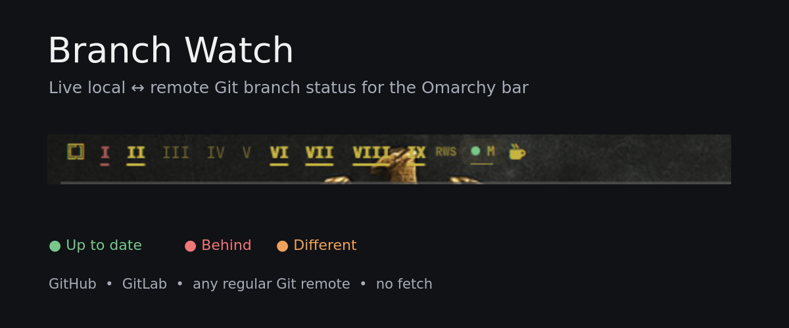

# Branch Watch

Branch Watch is a configurable Git branch monitor for the Omarchy bar. It
compares local branch commits with live refs on GitHub, GitLab, or any regular
Git remote without fetching or changing the repositories.



Each repository and branch can have a short bar label. The checked-out branch
is underlined. Hovering a branch shows its full repository, branch, remote,
checkout, status, and check time. Left-click refreshes; right-click opens the
configuration panel.

## Who it is for

Branch Watch is for anyone who wants an immediate overview of local and remote
repository state without repeatedly opening a terminal or Git client. It is
especially useful for:

- **Software developers** watching active development, release, or maintenance
  branches while they work.
- **Software testers and QA engineers** who need to know quickly when a new
  build candidate or testable commit is available on a monitored branch.
- **Release engineers and maintainers** keeping an eye on several repositories
  and long-lived branches at the same time.
- **Teams using GitHub, GitLab, or self-hosted Git** that want a compact status
  overview and optional desktop notifications directly in the Omarchy bar.

The goal is fast awareness rather than replacing a full Git client: Branch
Watch shows whether the monitored branch matches, differs from, or is provably
behind its live remote and can notify you when a new remote commit appears.

## Highlights

- GitHub, GitLab, self-hosted Git, and local `file://` remotes
- Any branch name, including `main`, `master`, `develop`, and `release/*`
- Automatic remote default-branch detection
- Multiple repositories and branches in one compact bar widget
- Desktop notifications for newly observed remote changes
- Existing SSH agents and HTTPS credential helpers; no credentials stored
- Strictly read-only repository inspection: no fetch, pull, checkout, or reset
- Horizontal and vertical Omarchy bars

## Statuses

| Colour | Status | Meaning |
|---|---|---|
| Green | Up to date | Local and live remote commits match |
| Red | Behind | The local commit is provably an ancestor of the remote commit |
| Orange | Ahead, diverged, or different | The commits differ; see the tooltip |
| Grey | Missing | The configured local branch does not exist |
| Yellow | Error | Repository, remote, branch, network, or authentication failed |

A newly observed remote commit is often initially **different**, not
**behind**. Branch Watch intentionally performs no fetch, so it may not have the
remote commit object required to prove the history relationship. It never
claims a branch is behind unless that ancestry can be established from objects
already present locally.

## Install

```bash
omarchy plugin add https://github.com/SmartALB/omarchy-branch-watch.git --enable
```

The plugin requires `git`, `jq`, GNU `timeout`, `flock` from `util-linux`, and
optionally `notify-send` from `libnotify`. These are normal Omarchy packages;
the plugin does not install packages or request privileges.

Right-click **GIT** in the bar to add repositories. If needed, move it:

```bash
omarchy bar move smartalb.branch-watch --section left
```

If the widget does not appear immediately after the first installation:

```bash
omarchy restart shell
```

## Quick start

1. Right-click **GIT** in the Omarchy bar.
2. Select **Add repository**.
3. Enter a display name and a short bar label.
4. Enter the path of the local Git working tree.
5. Keep the remote as `origin`, or enter another configured remote or URL.
6. Leave **Branches** empty to detect the remote default, or list branches
   explicitly.
7. Keep notifications enabled if desired and select **Save**.

Example for a repository whose real branches are `develop` and `master`:

```text
Name:                  Backend
Short bar label:       API
Local repository path: ~/projects/backend
Git remote:            origin
Branches:              develop=D, master=M
```

The branch syntax is always:

```text
real-branch-name=short-bar-label
```

For example, `develop=D` monitors the real branch `develop` and displays `D`.
Entering `D=develop` would instead try to find a real remote branch named `D`.

## Configuration

The panel writes a transparent JSON file:

```text
~/.config/omarchy/branch-watch.json
```

Example:

```json
{
  "schemaVersion": 1,
  "intervalMinutes": 10,
  "notifications": true,
  "repositories": [
    {
      "id": "backend",
      "name": "Backend",
      "label": "API",
      "path": "~/projects/backend",
      "remote": "origin",
      "notifications": true,
      "branches": [
        { "name": "develop", "label": "D" },
        { "name": "master", "label": "M" }
      ]
    },
    {
      "id": "website",
      "name": "Website",
      "label": "WEB",
      "path": "~/projects/website",
      "remote": "upstream",
      "notifications": true,
      "branches": []
    }
  ]
}
```

An empty `branches` array means: detect and watch the remote's default branch.
That may be `main`, `master`, `trunk`, or any other valid default. Explicit
branch names are never restricted to `main` or `master`; names such as
`release/2.x` work normally.

`remote` may be a configured remote name such as `origin` or `upstream`, or a
regular Git URL. The panel uses the compact syntax below for explicit branches:

```text
develop=D, master=M, release/2.x=R
```

The part after `=` is only the bar label.

### Choosing the local path

Point Branch Watch at the development checkout that owns the real Git remote,
not at an installed copy of a plugin or application. For example, an Omarchy
plugin installed from a local source may have a `file://` origin that points
back to the development checkout. Monitoring the development checkout itself
ensures Branch Watch contacts GitHub or GitLab rather than only comparing two
local directories.

Limits protect the long-running shell and helper process: 1 MiB configuration,
24 repositories, and 16 branches per repository.

## GitHub, GitLab, and authentication

Branch Watch is hosting-provider independent. Git performs the remote query using
the repository's existing remote configuration and credentials. SSH and HTTPS
both work. Queries are non-interactive:

- `GIT_TERMINAL_PROMPT=0`
- SSH `BatchMode=yes`
- per-command and whole-probe timeouts

Your SSH agent or credential helper must already be ready. Branch Watch does not
store credentials. Custom `ext::` transports are disabled; normal `file`,
`ssh`, `http`, `https`, and `git` transports are allowed.

Periodic checks contact the configured remote hosts and therefore reveal the
usual network metadata, including your IP address, at the configured interval.

## Read-only guarantee

Branch Watch runs remote queries and local object inspection only. It does not
run:

- `git fetch`
- `git pull`
- `git checkout` or `git switch`
- `git reset`
- ref or object writes

Lazy fetching in partial clones and optional Git locks are disabled. Linked
worktrees are supported. Shallow clones can be compared by exact commit ID,
but differing histories remain conservatively classified as **different**.

## Notifications and state

Notifications are enabled by default globally and can be disabled per
repository. A remote commit is notified once even when multiple monitor bars
run concurrently. Temporary network errors do not erase the remembered commit.

Private notification fingerprints are stored under:

```text
${XDG_STATE_HOME:-~/.local/state}/omarchy/branch-watch-state.json
```

The state directory is restricted to the current user. Removing the state file
only resets notification deduplication; it does not affect a repository.

## Troubleshooting

### “Branch does not exist on origin”

Confirm that the real branch name is on the left side of `=`:

```text
develop=D, master=M
```

You can verify the configured remote without fetching:

```bash
git -C /path/to/repository ls-remote --refs origin \
  refs/heads/develop refs/heads/master
```

### Authentication or timeout errors

Branch Watch never opens a password or passphrase prompt. Make sure the SSH key
is already available to the agent, or that the HTTPS credential helper can run
non-interactively. A useful SSH check is:

```bash
ssh -T git@github.com
# or
ssh -T git@gitlab.com
```

### “Different commit; history is unknown without fetching”

This is intentional. Branch Watch can see that the live remote SHA differs,
but it does not download the remote object merely to classify the relationship.
After you fetch through your normal Git workflow, the next check can classify
the state as behind, ahead, or diverged when the required objects are local.

### The bar widget is missing

Confirm it is enabled and present in the bar, then restart the shell:

```bash
omarchy plugin enable smartalb.branch-watch --section left
omarchy restart shell
```

## Manual checks

```bash
~/.config/omarchy/plugins/smartalb.branch-watch/bin/omarchy-branch-watch-check \
  --json \
  --config ~/.config/omarchy/branch-watch.json | jq

```

## Tests

The suite creates isolated temporary repositories and permits only `file://`
transport. It verifies `main`, `master`, arbitrary branches, custom remotes,
status classification, notification deduplication, configuration limits, and
that the probe changes no refs or objects.

```bash
test/run-tests.sh

omarchy plugin validate .
qmllint -I /usr/share/omarchy/shell Panel.qml
```

## Remove

```bash
omarchy plugin remove smartalb.branch-watch
```

The plugin manager removes the plugin and its bar entry. Configuration and
notification state are retained deliberately. Remove them manually if wanted:

```bash
rm ~/.config/omarchy/branch-watch.json
rm ~/.local/state/omarchy/branch-watch-state.json
```

## License

MIT. See [LICENSE](LICENSE).

The license retains Omarchy's upstream MIT notice for the shell widget patterns
used by this plugin.
